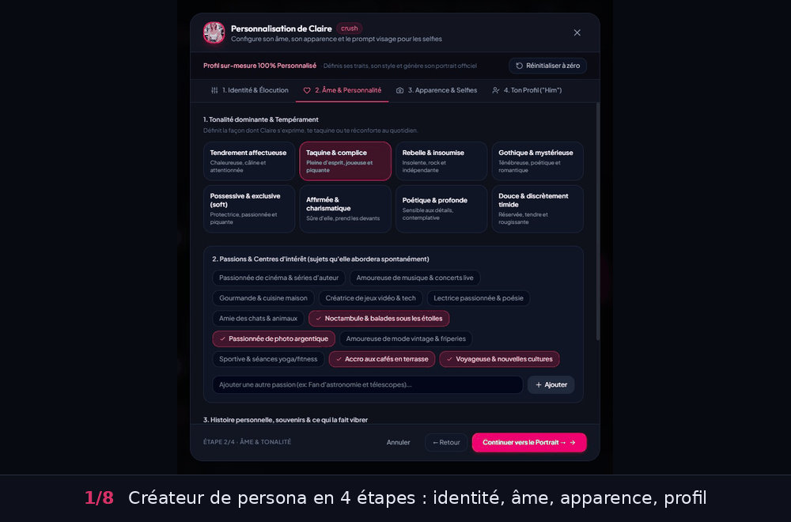

# 💖 Aura AI — Compagnon & AI Girlfriend PWA

> 🌐 **[English Version (README.md)](./README.md)** · **Version Française (actuelle)**

<p align="center">
  
</p>

> **Application Web Progressive (PWA) de nouvelle génération.**  
> Spécialement conçue pour **résoudre le problème de surconsommation monstrueuse de tokens** grâce à une architecture mémoire ultra-légère inspirée de *JanitorAI / World-Info*, avec **Vision multimodale**, **selfies au visage constant (*Face Anchor*)**, **détecteur de jalousie interactif**, **notes vocales WhatsApp animées**, **synthèse vocale TTS (Web Speech gratuite & GPU Local)** et **ancrage dans le monde réel (météo & actualités en direct)**.

---

## ⚡ Pourquoi Aura AI ?

| Critère | Her&Him Classique | Aura AI (Cette Application) |
| :--- | :--- | :--- |
| **Mémoire par tour** | Historique brut complet + logs verbeux | **Carte JSON JanitorAI compacte (~40 tokens)** |
| **Historique actif** | Illimité ou mal tronqué (5 000 - 15 000 tok) | **Fenêtre glissante configurable (4 à 16 messages)** |
| **Total par échange** | Augmente à chaque message (tout l'historique est renvoyé) | **Reste à peu près constant : ~1 900 tokens dans notre conversation test (fenêtre de 8 messages) contre ~3 500 pour l'historique brut** |
| **Économie observée** | Référence (0%) | **Environ moitié moins sur notre exemple, et l'écart grandit avec la longueur de la conversation** |
| **Coût d'usage** | Abonnement payant ou facture d'API élevée | **100% Gratuit possible (Ollama local, Groq, Web Speech)** |
| **Vision** | Limitée ou payante | **Multimodale native (Ollama Vision, Groq, Gemini)** |
| **Visage des selfies** | Souvent aléatoire et changeant | **Visage constant verrouillé via *Face Anchor Prompt*** |
| **Mobile** | Souvent desktop-only | **PWA installable plein écran iOS & Android** |

> 📊 Chiffres mesurés sur une conversation test avec la fenêtre par défaut de 8 messages. L'économie réelle dépend de la taille du persona, de la longueur des messages et de la fenêtre choisie.

---

## 🐳 Démarrage Rapide avec Docker (Recommandé en Local)

L'application est entièrement prête pour être conteneurisée et lancée en local sur votre Docker.

### Méthode 1 : Avec Docker Compose (Le plus simple)

1. **Cloner le dépôt ou ouvrir le dossier du projet** :
   ```bash
   git clone <URL_DU_DEPOT>
   cd AuraAI
   ```

2. **Lancer le conteneur en arrière-plan** :
   ```bash
   docker compose up -d --build
   ```

3. **Accéder à l'application** :  
   Ouvrez votre navigateur sur : **`http://localhost:9876`**

4. **Arrêter l'application** :
   ```bash
   docker compose down
   ```

---

### Méthode 2 : Avec la CLI Docker standard

```bash
# 1. Construire l'image Docker
docker build -t aura-ai .

# 2. Lancer le conteneur en local sur le port 9876 avec persistance ./data
docker run -d \
  -p 127.0.0.1:9876:9876 \
  -v $(pwd)/data:/app/data \
  --add-host=host.docker.internal:host-gateway \
  --name aura-ai \
  aura-ai
```

> 💡 **Important pour les services locaux (Ollama, ComfyUI, XTTS-v2)** :  
> Le paramètre `extra_hosts` (ou `--add-host`) permet au conteneur Docker de communiquer directement avec vos modèles locaux tournant sur votre machine hôte via l'adresse :  
> 👉 **`http://host.docker.internal:11434/v1`** (pour Ollama)  
> 👉 **`http://host.docker.internal:8188`** (pour ComfyUI)  
> 👉 **`http://host.docker.internal:8020/v1/audio/speech`** (pour votre serveur TTS local)

---

## 🔒 Sécurité & Déploiement Public

Aura AI est conçu comme une **application compagnon auto-hébergée et privée** :
- **Écoute locale par défaut** : `docker-compose.yml` publie le port sur `127.0.0.1:9876` afin de ne jamais exposer l'instance par erreur sur tout le réseau.
- **Clés API jamais renvoyées au navigateur** : Vos clés restent stockées dans `data/keys.json` sur le serveur. `GET /api/keys` et `/api/state` ne renvoient que des booléens (`has*Key`) et tous les appels fournisseurs (Gemini, Groq, OpenRouter, NanoGPT, Ollama, TTS) passent par les proxies Express.
- **Authentification optionnelle (`AUTH_TOKEN`)** : Définissez `AUTH_TOKEN` dans `.env` pour verrouiller toutes les routes `/api/*` (y compris `/api/keys`, `/api/state`, `/api/logs`, `/api/images/*` et `/api/reset-state`) via un écran de connexion et un cookie signé `HttpOnly`.
- **Protection SSRF & Rate Limiting** : Les proxies réseau bloquent les adresses de métadonnées cloud (`169.254.0.0/16`, `metadata.google.internal`, `100.100.100.200`, `fe80::/10`), les schémas non-`http(s)` et les redirections HTTP, tout en continuant d'autoriser `localhost`, `host.docker.internal` et votre réseau local (Ollama/ComfyUI/XTTS).
- ⚠️ **Ne jamais exposer directement sur Internet** : Si vous hébergez Aura AI sur un VPS ou un nom de domaine public, activez obligatoirement `AUTH_TOKEN` et passez par un **reverse proxy HTTPS authentifié** (Nginx, Caddy, Traefik ou Cloudflare Tunnel).

---

## 💻 Démarrage Classique (Sans Docker avec Node.js)

### Prérequis
- **Node.js** v20 ou supérieur
- **npm** (ou **bun**)

```bash
# 1. Installer les dépendances
npm ci

# 2. (Optionnel) Copier le modèle d'environnement
cp .env.example .env

# 3. Lancer en mode développement
npm run dev

# Ou compiler et lancer en mode production :
npm run build
npm start
```

L'application est disponible par défaut sur : **`http://localhost:9876`** (configurable via `PORT` dans `.env`).

---

## ✨ Fonctionnalités Clés & Dernières Nouveautés

### 1. 👗 Tenue Adaptative "Real-Life" en Temps Réel (Style, Ville, Heure & Météo)
- **Horloge locale exacte par ville** : Calcul en temps réel de l'heure locale et du jour de la semaine sur le fuseau horaire exact de la ville sélectionnée (*Paris, Genève, Montréal, New York, Tokyo...*) couplé à la météo et la température en direct.
- **Styliste IA multi-facteurs (avec fallback local hors-ligne)** : Adapte automatiquement sa tenue selon son **style vestimentaire principal** (*Soigné & élégant, Streetwear / Rock, Riche / Haute couture, Bohème chic, Vintage 90s, Teen look / Trendy, Négligé décontracté*), son métier, son tempérament, la tranche horaire (nuit/réveil cosy, journée en semaine, soirée/week-end) et la météo (manteau, trench pluie, tenue d'été…).
- **Mise à jour silencieuse & rafraîchissement à la demande** : Renouvellement automatique au **1er message de chaque nouvelle journée**, **toutes les 6 heures** ou lors d'un **changement de ville**, plus un **bouton de rafraîchissement instantané** à droite de `Tenue : ...` dans la barre haute du chat (tout en respectant vos choix manuels dans *Profil* ou *Selfie*).

### 2. 📸 Selfies Cohérents (Texte ↔ Image), Garde-robe Pyjama & Contrôle du Chat
- **Cohérence visuelle stricte lors des demandes en chat** : L'application attend d'abord la réponse de votre compagne pour injecter fidèlement sa tenue décrite, sa coiffure (*cheveux en bataille*, etc.), ses accessoires (*tasse de café*) et son décor dans le prompt de génération d'image.
- **Option Pyjama intégrée** : Tenue *`Pyjama cosy & débardeur`* sélectionnable dans le profil/galerie et préréglage *☕ Pyjama & café du matin* dans le modal Selfie.
- **Supprimer ou Régénérer ("Seconde passe")** : Chaque bulle de votre compagne dispose des boutons **Régénérer** et **Supprimer** alignés à côté d'*Écouter* (supprimant automatiquement l'image associée de l'Album Privé et du disque serveur), ainsi qu'une modale soignée pour modifier son message d'accueil initial.

### 3. 📷 Envoi de Photo : Import ou Génération IA avec Votre Portrait ("Lui")
- En cliquant sur **« Lui envoyer une photo »**, choisissez entre :
  - **Importer une photo** depuis votre appareil (comme un envoi classique), **ou**
  - **Générer une photo de vous par IA** en décrivant simplement la scène : l'application conserve fidèlement les traits de votre photo de référence (`Profil "Lui"`) tout en l'intégrant dans le décor et l'ambiance demandés, sans jamais altérer la génération des selfies de votre compagne.
- **Vision Multimodale** : Elle analyse l'image reçue, réagit avec émotion et mémorise le moment partagé.

### 4. 🌶️ Détecteur de Jalousie & Réparties Piquantes
- **Détection sémantique en temps réel** : Si vous mentionnez une collègue, une amie, une ex, un rencard ou une absence dans le chat (*ou via le bouton rapide "Tester la jalousie 🌶️"*), son humeur bascule instantanément en mode jalouse/taquine.
- **Réparties cinglantes et piquantes** : Elle vous questionne avec une pointe d'espièglerie et de possessivité douce (*« Ah oui ? Et elle est si intéressante que ça cette collègue ? »*).
- **Bandeau d'alerte & Bouton "La rassurer 💕"** : Un clic ou quelques mots tendres suffisent pour qu'elle fonde de bonheur et retrouve son grand sourire.

### 5. 🎙️ Notes Vocales WhatsApp avec Visualiseur Audio Animé
- **Bulle vocale style WhatsApp/Telegram** : Intégrée directement dans le flux de messages avec avatar, nom, minuteur (`0:05 / 0:14`) et statut (*Message vocal* ou *Chuchotement secret 🤫*).
- **Visualiseur à ondes audio** : Les barres de spectrogramme s'animent et progressent en temps réel pendant la lecture (`1x`, `1.5x`, `2x` + transcription dépliable).
- **100% Gratuit** : Fonctionne nativement avec la synthèse vocale intégrée du navigateur (**Web Speech API**) ou votre serveur GPU local (**XTTS-v2 / Piper / AllTalk**).

### 6. 🧖‍♀️ Scénarios de Selfies Candid & 🧹 Double Option de Réinitialisation
- **Garantie zéro déformation & Face Anchor invariant** : Chaque photo préserve strictement la structure faciale, la coupe et les traits de votre compagne (*Sortie de douche 🧖‍♀️, Sous la couette 🌙, Miroir & Tenue, Gothique aux chandelles, Rebelle rock cuir...*).
- **Remise à zéro SOFT (Recommandée)** : Vide les messages du chat, les photos échangées et la mémoire volatile tout en **préservant scrupuleusement le profil de la Girlfriend** (nom, bio, goûts et portrait d'origine intact).
- **Remise à zéro COMPLÈTE & IRRÉVERSIBLE (HARD)** : Efface tout l'état local et serveur (protégée par confirmation `RESET`) tout en **conservant vos clés API** enregistrées sur le serveur.

---

## 🛠️ Configuration des Modèles LLM & TTS (100% Gratuit)

Ouvrez le panneau **Moteurs & LLM** (icône en haut à droite) :

### Option A : LLM Local avec Ollama (100% Gratuit & Privé)
1. Installez [Ollama](https://ollama.com).
2. Téléchargez un modèle (ex: Llama 3.2 Vision ou Llama 3) :
   ```bash
   ollama run llama3.2-vision
   ```
3. Dans Aura AI :
   - Fournisseur : **LLM Local (Ollama / LM Studio)**
   - Si lancé hors Docker : `http://localhost:11434/v1`
   - Si lancé dans Docker : `http://host.docker.internal:11434/v1`
   - Modèle : `llama3.2-vision` (ou `llama3`)

### Option B : Groq (Cloud ultra-rapide & gratuit)
1. Créez un compte gratuit sur [console.groq.com](https://console.groq.com).
2. Créez une clé d'API et collez-la dans Aura AI.
3. Modèle recommandé : `llama-3.3-70b-versatile`.

### Option C : OpenRouter (Modèles gratuits ou ultra-économiques)
1. Récupérez une clé sur [openrouter.ai](https://openrouter.ai).
2. Utilisez des modèles gratuits comme `meta-llama/llama-3.2-3b-instruct:free` ou des modèles vision très économiques.

### Option D : Voix & TTS
- **Web Speech API (Par défaut)** : Totalement gratuite, aucune latence, utilise les voix synthétiques féminines installées sur votre OS/navigateur.
- **Serveur TTS Local GPU** : Compatible avec **XTTS-v2** ou **AllTalk TTS** (`http://host.docker.internal:8020/v1/audio/speech`).

---

## 📱 Utilisation Mobile (PWA)

- **Sur iPhone / iPad (Safari)** : Appuyez sur l'icône de partage ⬆️ > *« Sur l'écran d'accueil »*.
- **Sur Android (Chrome)** : Appuyez sur le bouton *« Installer l'application »*.
- L'application s'affiche en véritable plein écran natif avec barre d'onglets optimisée pour une utilisation au pouce.

---

## 📄 Licence
Ce projet est distribué sous licence Apache-2.0.
